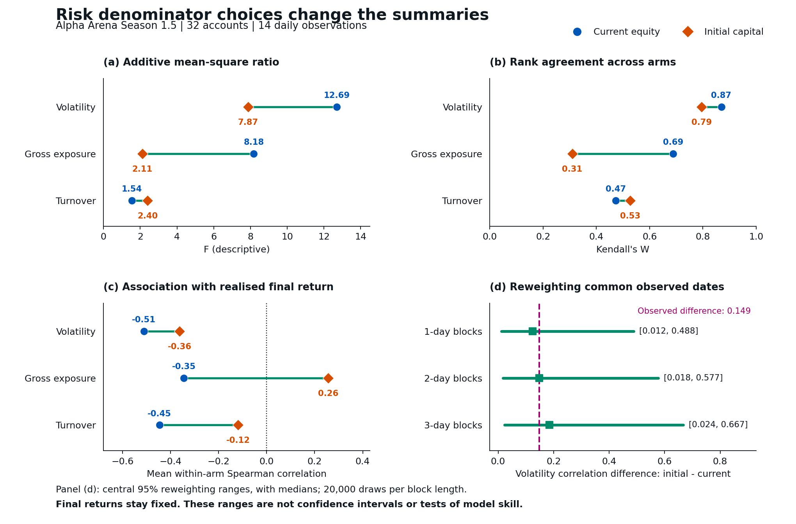

<div style="margin: 0; padding: 0; text-align: center; border: none;">
<a href="https://quantlet.com" target="_blank" style="text-decoration: none; border: none;">

</a>
</div>

```
Name of Quantlet: AlphaLuckDenominatorSensitivity

Published in: Trading versus Holding in a Live Language-Model Competition (working paper; not yet published)

Description: Recalculates descriptive mean-square ratios, rank concordance and risk-return correlations on current equity and initial capital from derived Alpha Arena account data. Common-date block reweighting retains all 32 accounts and both volatility definitions together while final outcomes remain fixed. The resulting ranges are sensitivity summaries, not confidence intervals or tests of model skill.

Keywords: risk measurement, volatility, trading, large language models, Spearman correlation, Kendall concordance, sensitivity analysis, resampling

Author: Daniel Traian Pele, Diana Ioana Micu, Victor Rareș Curescu, Miruna Mazurencu-Marinescu-Pele

Submitted: 15 October 2026, Daniel Traian Pele

Datafile: data/account_measures.csv, data/paired_daily_inputs.csv

Input: Derived Season 1.5 observations: 32 accounts, 8 models, 4 arms, and 14 daily equity changes.

Output: AlphaLuckDenominatorSensitivity.png, AlphaLuckDenominatorSensitivity.pdf, outputs/denominator_comparison.csv, outputs/joint_block_summary.csv, outputs/paired_leave_one_out.csv, outputs/verification.json

```
<div align="center">

</div>

