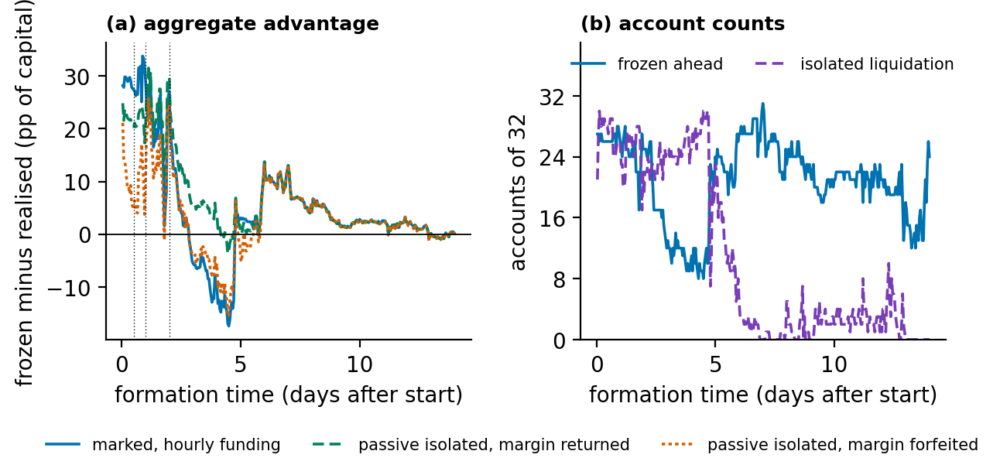

# AlphaLuckFormationHour

Season 1.5 frozen-book comparison for every formation hour, and two margin
policies that bracket feasibility.

```
python AlphaLuckFormationHour.py
```



## What it does

`data/sweep_accounts.csv` holds, for each formation hour 1-336 and each of
the 32 accounts, the hourly-funded frozen and realised results produced by
`src/organiser_hourly.py` in the reconstruction project (the 12-, 24- and
48-hour rows equal the published hourly-funding comparison to 1e-6 USD), and
the outcome under two margin policies:

- **account-wide**: frozen equity against summed asset maintenance margins
  (5 per cent per single stock, 2.5 per cent for XYZ100) on a five-minute grid;
- **passive isolated**: each frozen position keeps its formation isolated
  margin with no transfers; its threshold is the organiser's liquidation price
  for the same position, shifted for frozen funding, and pooled trade prints
  trigger liquidation, which returns (A) or forfeits (B) remaining maintenance
  margin.

The script recomputes every per-hour aggregate from the account rows, checks
them against `data/reference.json` and fails on any difference.

## Results

| Formation | Marked advantage (pp) | Ahead | Isolated accounts liquidated | Isolated A | Isolated B |
|---|---|---|---|---|---|
| 12 h | 27.33 | 26/32 | 27 | 20.36 | 5.74 |
| 24 h | 29.12 | 26/32 | 26 | 20.44 | 10.10 |
| 48 h | 27.07 | 25/32 | 19 | 29.57 | 24.32 |
| all 336 h | -17.4 to 33.8, positive in 269 | 8-31 | | positive in 307 | positive in 251 |

## Boundaries

- Organiser snapshots are not exchange records, and are not included here.
  Organiser liquidation prices follow the isolated-margin formula for the
  actual positions; they describe the frozen book only under the passive
  isolated policy.
- Pooled trade prints missed 2 of 14 actual liquidations whose position was
  unchanged since the last snapshot and raised no false alarm in 37,701
  fill-free intervals; mark prices, partial liquidation, fees and backstop
  rules are not replayed.
- Formation hours share one market path and are not independent observations.
