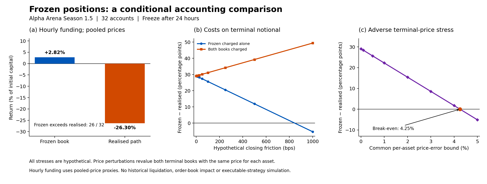

# AlphaLuckFrozenBenchmark

Reproduce a conditional comparison between realised trading and retaining each account's observed positions after the first 24 hours of Alpha Arena Season 1.5. The comparison uses hourly funding on both paths, with pooled fill prices as oracle proxies.

The 32 supplied account endpoints aggregate to a frozen marked return of **2.82%**, against **−26.30%** realised, with higher frozen values for **26 of 32** accounts. This is an accounting comparison on one observed market path. It does not establish that a frozen strategy could have survived historical liquidation or been executed at these prices.

## Run

Python 3.10 or newer is required. From this directory:

```sh
python -m pip install -r requirements.txt
python AlphaLuckFrozenBenchmark.py
```

The script also works when invoked from another directory: it resolves inputs relative to its own location. Use `--output PATH` to select another output folder. Execution is offline; no credentials or network requests are required.

## What is recomputed

The account CSV contains 32 derived hourly-funded profit-and-loss endpoints. The position CSV contains the frozen quantities, realised terminal quantities and common terminal price for seven instruments per account. The script computes account aggregates, terminal gross exposure, closing costs and price sensitivities from these rows. It does not read prerecorded sensitivity results.

For aggregate gap `D` and terminal gross exposures `N_F`, `N_A`, a hypothetical closing friction `c` gives:

- Frozen book charged alone: `D − c N_F`.
- Both books charged: `D − c (N_F − N_A)`.

A 100-basis-point charge on frozen terminal notional leaves a gap of **25.68 percentage points** and **26/32** positive paired differences. This is a hypothetical all-in charge, not an estimate of spread or market impact.

For an error bound `δ` on each terminal instrument price, applying the **same price perturbation to both books** changes the aggregate gap by `Σ z_k ε_k`, where `z_k = P_k Σ_i(q_F,ik − q_A,ik)`. The worst common-market gap is `D − δ Σ |z_k|`. A **4.25%** common adverse per-asset bound erases the aggregate advantage. This is a conditional threshold, not a measured pricing error or confidence interval. Separate accountwise worst-case bounds are also exported; their directions need not occur together in one market.

| Common adverse terminal-price bound | Gap, percentage points | Frozen higher |
|---|---:|---:|
| 1% | 22.28 | 24/32 |
| 2% | 15.43 | 21/32 |
| 5% | −5.10 | 13/32 |

Formation-price errors cancel if inherited equity and the retained book are revalued consistently. Quantities and recorded cash flows remain fixed. The endpoint-price and closing-cost exercises are separate stresses, not a joint uncertainty region.

## Outputs and verification

- `output/results.json`: aggregate results, conditional thresholds and limitations.
- `output/closing_cost_sensitivity.csv`: recomputed asymmetric and symmetric cost scenarios.
- `output/endpoint_price_sensitivity.csv`: recomputed common-market and accountwise bounds.
- `output/frozen_benchmark.png` and `.pdf`: comparison and stress graphic.
- `AlphaLuckFrozenBenchmark.png`: identical preview beside the entry script.

Every run verifies input hashes, the reference aggregates, all 128 vertices of the seven-instrument common-price stress, the closing-cost identity and the ordering of common-market versus separate-account bounds. A failed check stops execution.



## Provenance and limits

`data/provenance.json` records source-script hashes, derived-input hashes, the analysis window and terminal pooled-price ages. The inputs were derived by `src/funding_hourly_sensitivity.py` and `src/frozen_book_robustness.py` in the accompanying research project. This compact Quantlet reproduces the aggregation and sensitivity calculations **from those derived endpoints**; it does not independently rebuild the hourly funding stream from raw fills.

The formation cut was retrospectively selected. The 32 accounts share a market path and are not independent market replications. Pooled prices do not certify historical oracle or mark prices. Per-position collateral, margin modes, historical tiers, intra-grid liquidations and endogenous market impact are not reconstructed. A positive accounting difference cannot establish feasible trading performance, a causal effect of trading, or persistent model skill.

Primary technical sources: [Hyperliquid funding mechanics](https://hyperliquid.gitbook.io/hyperliquid-docs/trading/funding), [perpetuals API](https://hyperliquid.gitbook.io/hyperliquid-docs/for-developers/api/info-endpoint/perpetuals), and [liquidation mechanics](https://hyperliquid.gitbook.io/hyperliquid-docs/trading/liquidations). The data files are derived numerical extracts of public exchange records. Raw organiser responses, private data and credentials are not included. The code licence is MIT; it does not purport to license third-party raw data.

Prepared for the working paper *Trading versus Holding in a Live Language-Model Competition*. Preparation of this Quantlet does not imply journal acceptance or publication.
