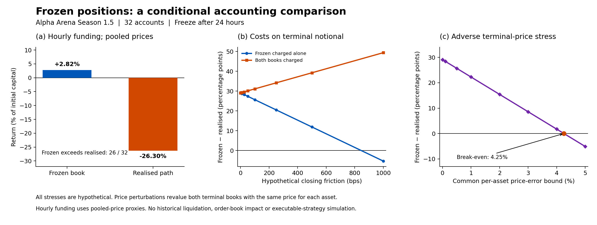

<div style="margin: 0; padding: 0; text-align: center; border: none;">
<a href="https://quantlet.com" target="_blank" style="text-decoration: none; border: none;">

</a>
</div>

```
Name of Quantlet: AlphaLuckFrozenBenchmark

Published in: Trading versus Holding in a Live Language-Model Competition (working paper; not yet published)

Description: Reproduces the Season 1.5 24-hour frozen-position accounting comparison from derived hourly-funded account endpoints and terminal quantities. Recomputes notional-based closing-cost and common endpoint-price stresses. It does not simulate an executable strategy, historical liquidations or market impact.

Keywords: LLM, trading agents, performance evaluation, frozen positions, funding, transaction costs, sensitivity analysis, reproducibility

Author: Daniel Traian Pele, Diana Ioana Micu, Victor Rareș Curescu, Miruna Mazurencu-Marinescu-Pele

Submitted: 2026-10-15

Datafile: data/accounts.csv, data/positions.csv, data/provenance.json

Input: Derived hourly-funded dollar profit and loss for 32 accounts and signed terminal quantities for seven instruments. Python 3.10 or newer; see requirements.txt.

Output: output/results.json, output/closing_cost_sensitivity.csv, output/endpoint_price_sensitivity.csv, output/frozen_benchmark.png, output/frozen_benchmark.pdf

Example: python AlphaLuckFrozenBenchmark.py

```
<div align="center">

</div>

